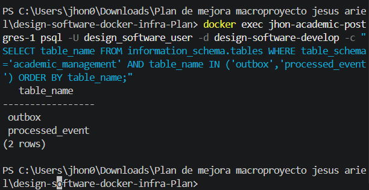
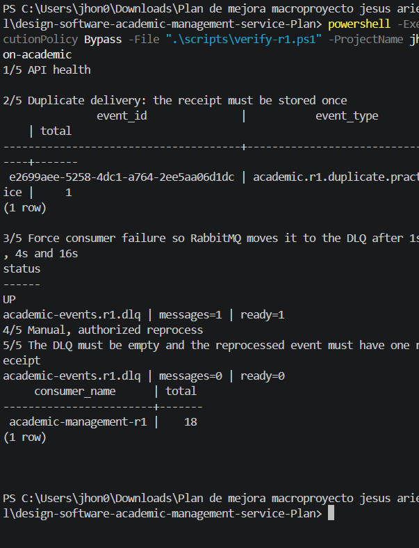
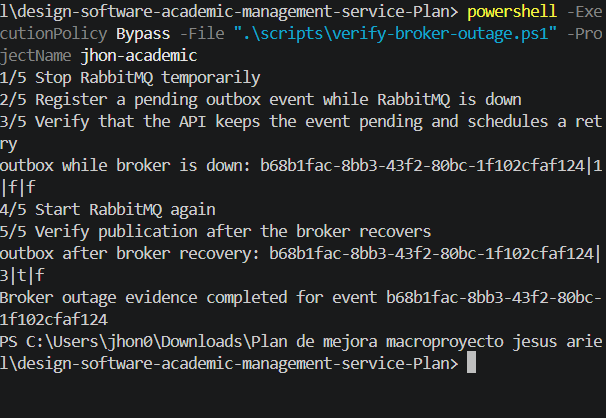
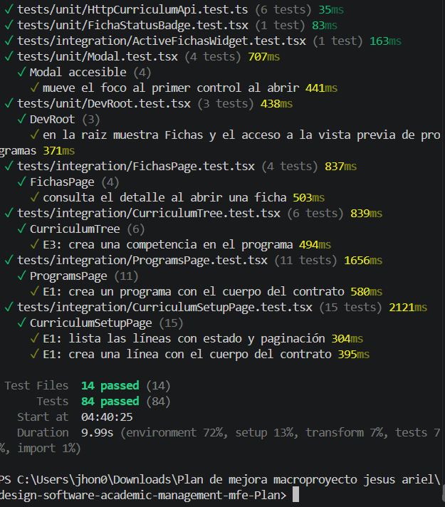
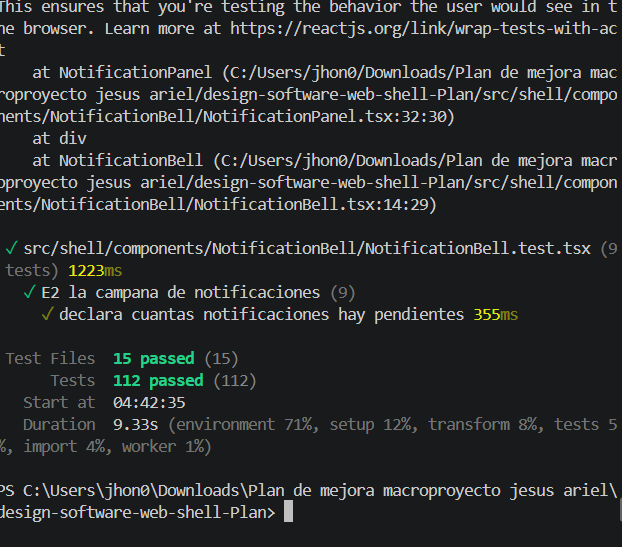
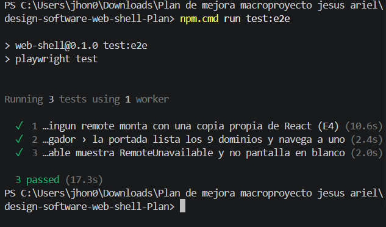
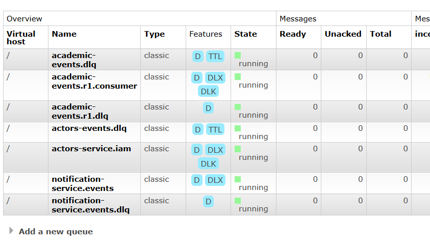
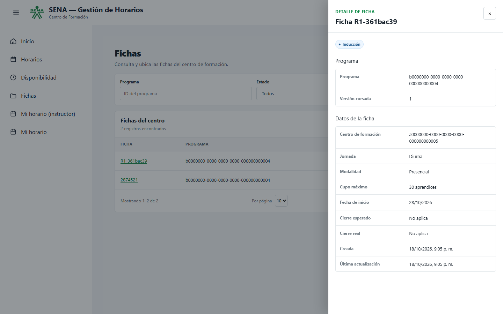

# Evidencia final de ejecución — 2026-10-18

**Aprendiz:** Jhon Camilo Suaza Sanchez
**Dominio:** `academic-management`
**Entorno local:** contenedores personales `jhon-academic-*`

## 1. Esquema de persistencia

La consulta a PostgreSQL confirmó las tablas requeridas para el reto:

```text
outbox
processed_event
(2 rows)
```



## 2. Idempotencia, DLQ y reproceso

La prueba `verify-r1.ps1` comprobó que dos mensajes con el mismo identificador
producen una sola recepción (`total = 1`). Luego forzó un fallo del consumidor:
la cola DLQ tuvo `messages=1`, y después del reproceso autorizado terminó con
`messages=0`.



## 3. Caída y recuperación de RabbitMQ

La prueba `verify-broker-outage.ps1` detuvo RabbitMQ antes de registrar un
evento de outbox. Mientras el broker estuvo caído, la salida indicó:

```text
retry_count=1 | published=false | dead_lettered=false
```

Al iniciar RabbitMQ de nuevo, la publicación se completó:

```text
retry_count=3 | published=true | dead_lettered=false
```



## 4. Frontend e integración de navegador

El MFE académico aprobó 84 pruebas. El Web Shell aprobó 112 pruebas unitarias y
la suite Playwright aprobó 3 pruebas E2E, incluido el montaje del remote
académico real.








## 5. Evidencia visual de RabbitMQ

La consola de administración de RabbitMQ muestra la cola
`academic-events.r1.dlq` en ejecución, con `Ready=0`, `Unacked=0` y `Total=0`
después del reproceso. También se observa la cola del consumidor R1.



## 6. Operación de negocio real y outbox

Se ejecutó una prueba adicional de creación de ficha mediante la API académica,
con el guion reproducible [`verify-business-outbox.ps1`](../../scripts/verify-business-outbox.ps1):

```powershell
powershell -ExecutionPolicy Bypass -File ".\scripts\verify-business-outbox.ps1" -ProjectName jhon-academic
```

El guion envió `POST /api/v1/fichas` con programa y centro de práctica, fecha
futura, jornada diurna, modalidad presencial y cupo 30. La API respondió `201`:

```text
HTTP 201 | ficha_number=R1-361bac39 | ficha_id=ceb35e9d-2242-4176-a5cd-3a36988d5d51
enrollment_ficha: ceb35e9d-2242-4176-a5cd-3a36988d5d51|R1-361bac39
outbox: 4412e478-cbe1-4873-8039-6c19a8954be2|academic.ficha.opened|t|t
```

En la última fila, el primer `t` confirma que el contenido del evento referencia
el mismo ID de ficha; el segundo indica que el relay ya lo había publicado. Una
consulta SQL independiente volvió a unir la ficha y el evento por ese ID. El
`GET /api/v1/fichas/ceb35e9d-2242-4176-a5cd-3a36988d5d51` respondió `200`.
Al actualizar el Web Shell, la nueva ficha apareció en una lista de dos registros
y se abrió su detalle:



El guion usa la API académica, PostgreSQL y RabbitMQ reales del entorno local.
Como el servicio de centros de formación no estaba levantado, inicia durante el
`POST` una respuesta temporal para el centro de práctica y la detiene al final;
la autenticación también usa el perfil local `dev`. La prueba confirma el camino
exitoso de ficha y outbox, pero no fuerza un rollback ni valida IAM o referencia
de centros reales. La prueba de caída del broker de la sección 3 cubre por
separado la conservación y publicación posterior de un evento pendiente.

## 7. Caos con reinicio de la API y entrega duplicada

El guion reproducible [`verify-r1-chaos-restart.ps1`](../../scripts/verify-r1-chaos-restart.ps1)
se ejecutó desde la raíz del repositorio personal del servicio:

```powershell
powershell -ExecutionPolicy Bypass -File ".\scripts\verify-r1-chaos-restart.ps1" -ProjectName jhon-academic
```

Detuvo RabbitMQ, insertó un evento de práctica en outbox y confirmó que seguía
pendiente. Después reinició la API **mientras RabbitMQ continuaba detenido**,
recuperó el broker y comprobó la publicación y una recepción. Finalmente
entregó otra vez el mismo `event_id` y verificó que `processed_event` no aumentó:

```text
Broker detenido | outbox: 9baa5104-2b4c-4fb6-bc97-d913c58723ef|1|f|f
API reiniciada | antes=2026-10-19T00:15:17.924578589Z | despues=2026-10-19T02:34:46.460923641Z
Broker recuperado | outbox: 9baa5104-2b4c-4fb6-bc97-d913c58723ef|2|t|f | processed_event=1
Duplicado entregado | processed_event antes=1 | despues=1
CAOS R1 APROBADO | event_id=9baa5104-2b4c-4fb6-bc97-d913c58723ef | publicado=t | procesado=1 | duplicado=1
```

Una consulta SQL independiente devolvió
`9baa5104-2b4c-4fb6-bc97-d913c58723ef|2|t|f|1` para identificador, número
de reintentos, publicación, envío a DLQ y total de recepciones. Los tiempos
`StartedAt` de Docker están en UTC. El guion intenta recuperar RabbitMQ incluso
si la ejecución falla. Esta prueba valida la recuperación y deduplicación de un
evento de mensajería de práctica insertado directamente en outbox; la operación
de negocio por API se documenta en la sección 6 y se probó por separado.

## 8. Flujo académico con dependencias reales

El 19 de octubre se aplicaron las migraciones reales de reference-data (18
changesets) e IAM (37 changesets) al PostgreSQL local. IAM inició en
`localhost:8001`, su health y JWKS respondieron `200`, y emitió un JWT para la
cuenta local `r1-academic-demo@example.test` con rol `SYSTEM_ADMIN`.

El servicio real de datos de referencia inició en `localhost:8080`. Con ese
JWT, devolvió el centro semilla activo `9201`:

```text
REFERENCE_CENTER_OK|a0000000-0000-0000-0000-000000000005|9201|active=True
```

La API académica se inició sin el perfil `dev`, con
`IAM_JWKS_URI=http://iam-api:8080/api/v1/auth/.well-known/jwks.json` y
`REFERENCE_DATA_BASE_URL=http://host.docker.internal:8080`. El MFE académico
también se inició desde Docker y su `remoteEntry.js` respondió HTTP 200 en el
puerto 5103.

Con el JWT emitido por IAM se creó una ficha mediante `POST /api/v1/fichas`:

```text
ACADEMIC_HEALTH=UP
FICHA_CREATED|11400358-ff3d-4250-9adb-a62be0010d26|R1-REAL-47e446e6
11400358-ff3d-4250-9adb-a62be0010d26|R1-REAL-47e446e6|t
```

La última salida es una consulta independiente de PostgreSQL: confirma la
ficha creada y que existe un evento `academic.ficha.opened` cuyo payload
referencia el mismo identificador. No se inició el contenedor temporal de
Python ni se usó `local-practice-token` en este recorrido.
