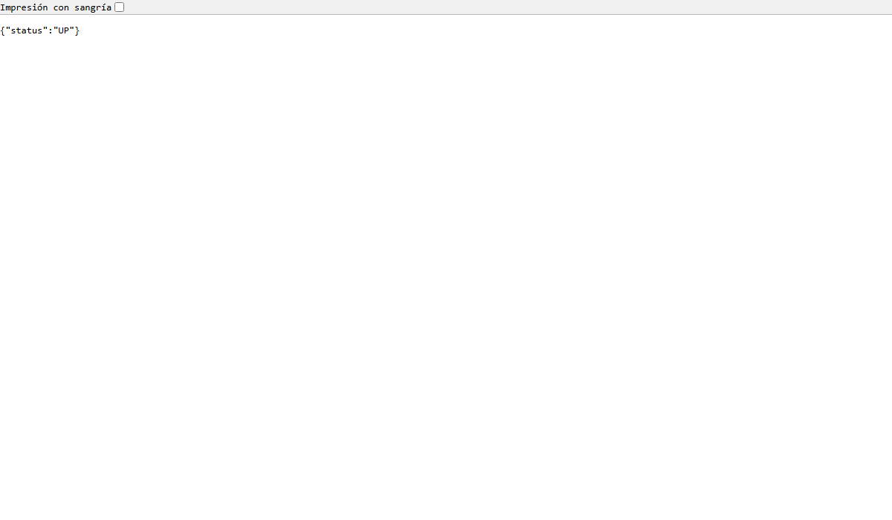

# Informe técnico R1: resiliencia y mensajería

**Aprendiz:** Jhon Camilo Suaza Sánchez  
**Dominio:** academic-management  
**Fecha:** 2026-10-16

## Alcance implementado

Se completó la ruta de eventos del dominio con outbox transaccional, confirmación de publicación, reintentos exponenciales, cola muerta, reprocesamiento manual e idempotencia del consumidor. La migración 009 crea `processed_event`; el servicio conserva el outbox ya incluido en la base oficial y endurece su relay para no marcar un evento como publicado sin `ack`.

El stack de validación integra PostgreSQL, Liquibase, RabbitMQ, reference-data y academic-api. El microfrontend usa el token entregado por el shell, consume el API académico real y presenta las rutas de fichas, programas y configuración curricular. La infraestructura expone el API académico en el puerto 8003 y reference-data en 8002.

## Flujo verificado

1. La transacción escribe el evento en `academic_management.outbox`.
2. El relay publica con `message_id=event_id` y espera publisher confirm.
3. El consumidor registra el evento mediante una inserción atómica; una redelivery encuentra la clave y no repite el efecto.
4. Los fallos de consumo se intentan cuatro veces y terminan en `academic-events.r1.dlq`.
5. Un operador con `ACADEMIC_EVENTS_REPROCESS` puede invocar `POST /api/v1/events/dlq/reprocess-next`.

## Resultados y métricas

| Verificación | Resultado |
|---|---:|
| Pruebas unitarias Java ejecutadas | 51 correctas |
| Pruebas del MFE | 85 correctas |
| Build del MFE | correcto |
| Migraciones academic-management | 31 changeSets correctos |
| Migraciones reference-data | 18 changeSets correctos |
| Salud academic-api | HTTP 200 / UP |
| Salud reference-data-api | HTTP 200 / ok |
| Eventos enviados en prueba de duplicado | 2 |
| Efectos persistidos para el duplicado | 1 |
| Mensajes inválidos enviados a DLQ | 1 |
| Eventos perdidos en la caída controlada | 0 |

Los comandos y salidas resumidas están en `docs/evidence/test-results.txt` y `docs/evidence/chaos-results.txt`. La prueba completa se reproduce con `scripts/verify-r1-chaos.ps1`.

## Limitación externa identificada

El repositorio oficial de `web-shell` importa paquetes de `design-system` y `frontend-platform`, pero esos repositorios no están publicados bajo los nombres indicados por HU-SHELL-006, HU-SHELL-007 y HU-SHELL-008. Por eso se dejó preparada la integración del remote académico en el shell, pero no se puede compilar ni capturar la navegación completa del host hasta recibir esas dos fuentes. El MFE académico, su API y la mensajería sí quedaron compilados y probados de forma independiente.

## Evidencias para la sustentación

- Explicar el riesgo de doble escritura y la decisión del ADR.
- Mostrar `outbox`, `processed_event` y las dos colas DLQ en RabbitMQ.
- Ejecutar el script de caos y señalar `R1_CHAOS_RESULT=PASS`.
- Mostrar las pruebas del consumidor idempotente y del publisher confirm.
- Explicar que los PR se dirigen a `develop` de los repositorios personales.
